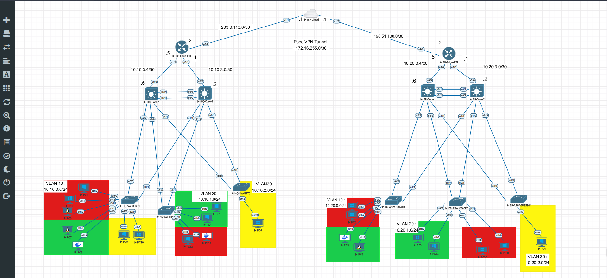

# 🌐 Enterprise Network Architecture - Dual Site (HQ & Branch)

###  Project Overview
I designed and implemented a **dual-site enterprise network (HQ and Branch)** connected securely over a public ISP. The architecture focuses on high availability, multi-tenant segmentation, defense-in-depth security, WAN optimization, and centralized management.

---

##  Architecture & Technologies

### Phase 1: Layer 2 & High Availability Infrastructure
*   **Hierarchical Switching:** Deployed Core and Access switches at both sites.
*   **Traffic Segmentation (VLANs):** Created dedicated VLANs for Users (VLAN 10), Voice (VLAN 20), and Guests (VLAN 30).
*   **Guest Network Isolation (VRF):** Deployed a dedicated **Virtual Routing and Forwarding (VRF)** instance for the Guest VLAN. This creates a completely separate routing table, ensuring guest traffic is logically isolated from corporate routes (VLANs 10 & 20) and cannot laterally move into internal subnets.
*   **First-Hop Redundancy (HSRP):** Configured Active/Standby HSRP on the dual Core switches to provide resilient default gateways for all VLANs.
*   **Link Aggregation (LACP):** Established EtherChannels between Core switches for increased bandwidth and Layer 2 loop prevention.

### Phase 2: Secure WAN Overlay & Routing
*   **Site-to-Site VPN:** Built a GRE-over-IPsec VPN tunnel connecting the HQ and Branch Edge routers across the ISP.
*   **Fragmentation Prevention:** Tuned interface MTU (1400) and TCP MSS (1360) to prevent packet drops inside the encrypted tunnel.
*   **NAT Strategy:** Configured NAT Overload (PAT) for Internet breakout, alongside NAT Exemption ACLs to ensure cross-site corporate traffic routes securely through the VPN without translation.
*   **Multi-Area OSPF:**
    *   **Area 0 (Backbone):** Deployed exclusively across the VPN tunnel.
    *   **Area 10 & 20:** Configured for HQ and Branch local routing. This isolates LSA flooding and keeps routing tables stable.
    *   **VRF Route Leaking:** Configured to ensure the Guest VRF only receives a default route to the Internet, preventing guest traffic from entering the global OSPF routing table.

### Phase 3: Security Hardening (Control & Access Planes)
*   **Routing Security:** Enforced OSPF MD5 Cryptographic Authentication to prevent rogue routers from injecting false routes.
*   **Management Security:** Generated 2048-bit RSA keys, enforced SSHv2, and restricted VTY access via ACLs (whitelisting only admin subnets).
*   **Brute-Force Protection:** Enabled login rate-limiting (`login block-for`) on all routers.
*   **CPU Protection (CoPP):** Deployed Control Plane Policing on Edge and Core devices to rate-limit high-volume CPU-bound traffic (ICMP, ARP, routing protocols), protecting against DoS attacks.
*   **Layer 2 Security:** Deployed **DHCP Snooping** (to stop rogue DHCP servers) and **Dynamic ARP Inspection / DAI** (to stop Man-in-the-Middle ARP poisoning). Configured binding table persistence to flash to survive reboots.

### Phase 4: Quality of Service (QoS)
*   **Edge Router LLQ:** Configured Low Latency Queuing (LLQ) to give strict priority to Voice traffic (DSCP EF) over data traffic.
*   **Traffic Shaping:** Applied a shaper (e.g., 90Mbps) to the WAN and Tunnel interfaces to account for IPsec overhead and prevent the ISP from dropping bursty traffic.

### Phase 5: Management & Visibility (NOC Essentials)
*   **NTP (Time Synchronization):** Configured `HQ-Edge-RTR` as the NTP Master (Stratum 3) and synced all network devices to it. This ensures accurate log timestamps.
*   **Syslog:** Pointed all devices to a management VPC (`10.10.0.4`) to push centralized event logs.
*   **SNMPv3:** Configured secure monitoring using SHA Authentication.

---

## Network Topology


---

## 📂 Repository Structure
```text
Enterprise-Network-Project/
├── Configurations/          # Full device configuration files (HQ & Branch)
├── Documentation/           # Exported lab assets and documentation
├── Topology/                # Network diagram images
└── README.md
